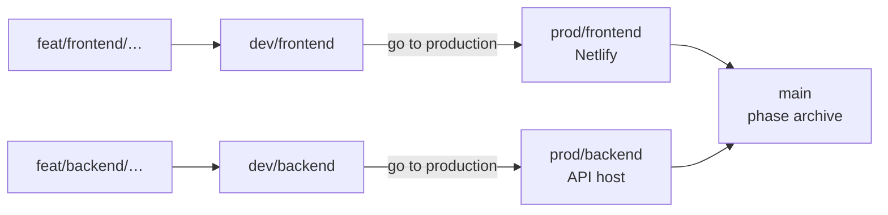

<!-- agent-project-framework:readme -->
# DevOpt

**Start right. Ship small. Spend less.**

A portable operating system for AI-assisted products. Drop it into a repo and every coding agent — Cursor, Claude Code, Codex, Copilot, Gemini, OpenCode, Windsurf, and the rest — gets the same answers: where we are, what to build, how to branch, and which files to open.

It is not a prompt pack. It is a small set of gates, profiles, and scripts that stop the expensive failure modes: building before speccing, rereading the whole repo, mixing frontend and backend, and shipping to production without a human.

[](https://github.com/udithsandaruwan2/devopt-framework/actions/workflows/framework-check.yml)


[](LICENSE)

---

## Default stack

| Side | Default | Opt-in |
|---|---|---|
| Frontend | React + Vite + TypeScript on **Netlify** | — |
| Backend | **Django 5 + DRF** (`uv`) | FastAPI · NestJS |
| Layout | `apps/web` + `apps/api` | trunk-based single app (`--trunk`) |

Backend work loads the Django profile only. Nest and FastAPI stay on disk until you ask for them.

```bash
./scripts/bootstrap.sh ~/projects/my-app "My App"                 # Django
./scripts/bootstrap.sh ~/projects/my-app "My App" --backend-nest  # Nest
./scripts/bootstrap.sh ~/projects/my-app "My App" --backend-fastapi
```

---

## Git: four tracks, then main

Frontend and backend ship independently. Production is a human sentence, not a green CI run.



1. Many commits on `feat/<track>/<slug>`.
2. Feature end → merge to `dev/<track>` → test locally.
3. You say **go to production** → `./scripts/promote.sh <track> prod --apply`.
4. After a phase → `./scripts/promote.sh phase --apply` (both prod tracks → `main`).

`promote.sh` dry-runs unless you pass `--apply`. Agents are not allowed to skip that.

---

## Quickstart

```bash
./scripts/bootstrap.sh ~/projects/my-app "My App"
cd ~/projects/my-app
git init && ./scripts/install-hooks.sh

# long-lived tracks
git switch -c dev/frontend && git switch -c dev/backend
git switch -c prod/frontend && git switch -c prod/backend
git switch main

./scripts/doctor.sh
./scripts/token-audit.sh
```

Open the project in any agent:

> Read `AGENTS.md` and `project/STATE.md`. Run `project-kickoff` for phase 0.

Existing repo:

```bash
./scripts/bootstrap.sh /path/to/repo "Existing App" --force --copy
```

Review the diff before you commit. Bootstrap may overwrite `.gitignore`, `.editorconfig`, or `Makefile`.

---

## How agents spend fewer tokens

| Mechanism | What it does |
|---|---|
| Thin `AGENTS.md` (~1.6k tokens) | The only mandatory read |
| Skills by description | 12 procedures, ~650 tokens of names |
| `./scripts/context-pack.sh implement-api` | Ordered allowlist — Django profile, not Nest |
| One stack profile per task | Never load React + Django + Nest together |
| Work order + **track** | Frontend and backend stay on separate lines |
| `promote.sh` dry-run | Production only when a human says so |
| S / M / L / XL sizing | Small tasks skip planning loops |
| Handoff at ~60% | Fresh session instead of bloated compaction |

```bash
./scripts/context-pack.sh --list
./scripts/context-pack.sh implement-web
./scripts/context-pack.sh implement-api    # Django by default
```

---

## What you get

```
AGENTS.md                 always-on rules (~119 lines)
framework.conf            budgets, git model, selected profiles
.agents/skills/           12 on-demand procedures
.agents/profiles/         Django · FastAPI · Nest · React/Vite/Netlify
.agents/packs/            file allowlists for context-pack.sh
project/                  living truth: STATE, brief, PRD, ADRs, plan
docs/                     playbooks — open one
scripts/                  bootstrap, promote, doctor, token-audit
```

Phase model:

```
0 Intake ─G0→ 1 Discovery ─G1→ 2 Product ─G2→ 3 Architecture ─G3→
4 Plan ─G4→ 5 Build ─G5→ 6 Release ─G6→ 7 Operate
```

Agents may propose a gate. Only a human approves one.

---

## Agents and IDEs

| Tool | Entry file |
|---|---|
| OpenCode, Codex, Jules, Amp, Factory | `AGENTS.md` |
| Claude Code | `CLAUDE.md` + `.claude/skills/` |
| Cursor | `.cursor/rules/*.mdc` |
| GitHub Copilot | `.github/copilot-instructions.md` |
| Gemini CLI | `GEMINI.md` |
| Windsurf / Roo / Zed / Aider / Junie | generated adapters |

One source of truth. Run `./scripts/sync-adapters.sh` after you edit `AGENTS.md` or a skill. Details: [docs/11-agent-adapters.md](docs/11-agent-adapters.md).

---

## Everyday commands

```bash
make doctor                          # structure, links, budgets
make audit                           # token table
make pack PACK=implement-api         # files the agent may open
make promote ARGS="frontend prod"    # dry-run promotion
make sync                            # regenerate IDE adapters
./scripts/new.sh adr "Use Postgres"
./scripts/new.sh spec "Quick capture"
./scripts/new.sh task "Add capture form"
```

---

## Design principles

1. **One source of truth.** Rules in `AGENTS.md`, state in `project/`, procedures in skills.
2. **Progressive disclosure.** Load the smallest tier that can answer the question.
3. **Gates before code.** Documents are cheaper than rewrites.
4. **Small diffs.** One task, one track, one reviewable change.
5. **Measure context.** Budgets and audits, not vibes.
6. **Humans own production.** Agents propose and implement; they do not promote.

Research notes: [docs/13-research-notes.md](docs/13-research-notes.md). Human guide: [docs/00-start-here.md](docs/00-start-here.md).

## License

[MIT](LICENSE) © 2026 Udith Sandaruwan
